# MirrPane (鏡屏)


[繁體中文](README.md) | **English**

**An AirPlay screen mirroring receiver for Windows**, built with **Go + FFmpeg D3D11VA + MyGo**. Turn your Windows PC into a wireless display for an iPhone or iPad with a native desktop UI. Ships as a per-user installer (no administrator rights) and as portable archives that run where they are extracted; the portable builds write no registry keys and need no extra runtime installed.

- **License**: [GPL-3.0 License](https://github.com/Miku0139oao/MirrPane/blob/main/LICENSE)
- **Repository**: [Miku0139oao/MirrPane](https://github.com/Miku0139oao/MirrPane)
- **Stable release v0.5.1** · [Windows installer (recommended)][setup] · [Portable, full][win64] · [Portable, lite][lite] · [Release notes][release] · [Tagged source][source-tag]

---

## Features

- **Low-latency hardware decoding**: FFmpeg **D3D11VA** provides H.264 hardware acceleration. Complete Annex-B access units go directly to the decoder. Software decoding is available when hardware acceleration is unavailable and can also be selected in settings.
- **One CGO-free executable**: The desktop UI (MyGo) and the AirPlay receiver are the same `MirrPane.exe`, built with `CGO_ENABLED=0`. The UI re-executes itself with the internal `--airplayd` argument to start the receiver. FFmpeg is bound at runtime through `purego` and Windows system APIs are called from Go. No Visual Studio C++ compiler, MinGW, or FFmpeg development headers are needed.
- **One executable, two processes**: The release ships only `MirrPane.exe`. The UI self-re-executes with `--airplayd` to start the receiver child; the two communicate through shared memory and a loopback HTTP API, and the receiver exits with the UI.
- **Shared-memory frame rendering**: The backend publishes RGBA frames to a Windows shared-memory section unique to each UI instance (`Local\MirrPaneFrames-<pid>`). A three-slot mailbox and Windows event notifications deliver frames to the native MyGo UI (`internal/framefeed`), which maps the section directly and uploads it as a texture. This avoids image serialization between processes and keeps two instances from fighting over one section; a manually launched `MirrPane.exe --airplayd` still defaults to `Local\YingpingFrames`.
- **Direct-to-slot conversion with idle gating**: `sws_scale` writes straight into the claimed shared-memory slot (no full-frame copy per picture). When the UI is minimised or stops adopting frames for a second, the download, conversion and publish are skipped while decoding continues (reference frames), with a 1 Hz probe so the UI can re-adopt instantly on restore.
- **Low-latency audio playback**: AAC-ELD audio is decoded and played through Windows `winmm waveOut`. Supports live volume control, mute, and three latency/jitter profiles (low, balanced, stable) backed by a larger ring that absorbs Wi-Fi bursts. The ring gently catches up when a burst raises occupancy, so latency does not stay elevated for the rest of the session.
- **Live pipeline telemetry**: `/api/state` reports fps, mean/p95 for decode, GPU download, colour conversion and publish, consumer adoption progress, and audio buffer metrics.
- **Automatic FFmpeg management**: Pins a dated upstream build (SHA256 and ABI checked), detects existing runtimes, and supports resumable first-run downloads. DLLs are resolved only from explicit trusted locations — never `PATH` or the working directory.
- Mirroring and audio streams use the paired device’s identity and are bound to the sender. A verified device is trusted on first use, so its first connection starts without a trip to the PC; enable **首次連線需人工核准** (Require manual approval) in Settings to gate each new device. The local management API validates `Host` and `Origin`. See [Security](#security).
- **Portable distribution**: In the portable builds, settings (`config.json`), UI preferences, and pairing keys stay in the application directory. The app does not write to the Windows registry and needs no administrator rights. The installer places the app under `%LOCALAPPDATA%\Programs\MirrPane` and adds only the standard per-user uninstall entry. The one exception is the MyGo shader cache that the UI creates under `%LOCALAPPDATA%\MyGo\ShaderCache` on first launch.
- **Single instance and a lite package**: One receiver per logon session; launching again brings the running window to the front instead of starting a second receiver that would fight over the AirPlay port and advertise a duplicate name. A lite archive without FFmpeg is available too (about 10 MB); it downloads and SHA-256-verifies the pinned runtime on first launch.
- **Android mirroring (ADB / scrcpy)**: Connect an Android phone with USB debugging enabled, or a paired wireless-debugging device, and MirrPane mirrors its screen while your mouse, wheel and keyboard operate the device (Back, Home, Recents, Rotate, arrow keys). Audio from Android 11 and later plays as 48 kHz stereo through the same volume, mute and anti-jitter buffering. It uses the system's `adb` (Android Platform Tools) and embeds the pinned [scrcpy](https://github.com/Genymobile/scrcpy) server 5.0.1 (Apache-2.0), so scrcpy itself does not need to be installed.

---

## Architecture

<picture>
  <source media="(prefers-color-scheme: dark)" srcset="assets/mirrpane-architecture-dark.svg">
  
</picture>

```text
iPhone / iPad (AirPlay / mDNS)
        │
        ▼
Receiver process: MirrPane.exe --airplayd (self re-exec, CGO_ENABLED=0)
  ├── mDNS / Bonjour advertisements (zeroconf)
  ├── FairPlay key exchange and AirPlay pairing (pair-setup / pair-verify)
  ├── Video: purego bindings to FFmpeg D3D11VA (H.264 Annex-B)
  └── Audio: AAC-ELD → Windows winmm waveOut (low / balanced / stable)
        │
        ▼  Video: three-slot shared-memory mailbox (Local\MirrPaneFrames-<pid>)
        │         + Windows event notifications
        │  State and controls: local HTTP API (IPC)
        ▼
UI process: the same MirrPane.exe (MyGo native window, CGO_ENABLED=0)
  └── framefeed shared-memory reader → ui.Bitmap texture
```

The UI and the receiver are one executable: on launch the UI re-executes itself with `--airplayd`, and the receiver child exits with the UI.

---

## Project Layout

```text
MirrPane/
├── .github/workflows/          # CI and release workflows
├── backend/                    # Go module: github.com/miku0139/airplay-go/backend
│   ├── cmd/
│   │   ├── ffmpeg-setup/       # Shared FFmpeg DLL download, verification, and installation
│   │   └── mirrpane/           # Native MyGo desktop UI and self re-exec (main.go, app.go, sidecar.go, prefs.go, …)
│   ├── internal/
│   │   ├── adb/                # Android Platform Tools (adb) process and device discovery
│   │   ├── airplayd/           # Receiver process entry point (--airplayd mode; main.go, sink.go, state.go, record.go, …)
│   │   ├── audio/              # Audio stream reception, decryption, and AAC-ELD decoding flow
│   │   ├── audioout/           # Windows waveOut playback and jitter buffering
│   │   ├── config/             # config.json persistence
│   │   ├── decode/             # purego FFmpeg bindings and video/audio decoding
│   │   ├── fairplay/           # FairPlay key exchange and decryption
│   │   ├── ffmpeg/             # Runtime discovery, download, verification, and caching
│   │   ├── framefeed/          # Shared-memory frame reader used by the UI
│   │   ├── frames/             # Frame publication and shared-memory layout
│   │   ├── ipc/                # AirPlay RTSP control endpoints and packet parsing
│   │   ├── mdns/               # AirPlay mDNS / Bonjour advertisements and discovery
│   │   ├── mirror/             # Screen mirroring stream reception and Annex-B processing
│   │   ├── pairing/            # AirPlay pair-setup / pair-verify
│   │   ├── protocol/           # Device information, feature flags, and LAN interface selection
│   │   ├── receiver/           # Receiver coordination
│   │   └── scrcpy/             # Android scrcpy v5.0.1 client (protocol, control messages, embedded server jar)
│   ├── go.mod
│   └── go.sum
├── assets/                     # Project logo, Windows icon, and system architecture diagrams
├── scripts/
│   ├── fetch-ffmpeg.ps1        # Detect or download the pinned Windows x64 shared build (SHA256)
│   ├── generate-app-icon.ps1   # Generate the Windows ICO and executable icon resource from assets/logo.png
│   ├── generate-ffmpeg-abi.ps1 # Generate FFmpeg ABI definitions
│   └── third-party-notices.ps1 # Collect the licences of bundled Go modules
├── third_party/                # Local third-party dependencies, such as FFmpeg
├── LICENSE                     # GPL-3.0 license
├── README.md                   # Traditional Chinese documentation
├── README.en.md                # English documentation
├── VERSION                     # Release version read by package.ps1
└── package.ps1                 # Build, package, and SHA256 script
```

---

## Quick Start

1. Run the [Windows installer][setup] (per-user, no administrator rights; installs to `%LOCALAPPDATA%\Programs\MirrPane` with a Start Menu shortcut and an uninstall entry), or extract the [portable archive][win64] / [lite archive][lite] to a writable folder and run `MirrPane.exe`. To verify a download, compare its SHA-256 from `Get-FileHash` with the `.sha256` file next to it. The lite build downloads and verifies the FFmpeg runtime on first launch, so it needs a network connection once.
2. Connect the Windows PC and your iPhone or iPad to the same local network. Allow the receiver on private networks when Windows Firewall prompts you.
3. On your iPhone or iPad, open **Control Center → Screen Mirroring**, then select the receiver. Its default name is **鏡屏**.
4. The first connection needs no approval on the PC: a paired device is added to the trust list automatically and mirroring starts. If you enable **首次連線需人工核准** (Require manual approval) in Settings, confirm the device name on the PC and click **允許連線** (Allow connection), then select the receiver again on the iPhone or iPad.
5. Keyboard shortcuts include `F11` (full screen), `Ctrl+T` (always on top), `Ctrl+,` / `Ctrl+K` (settings), `Ctrl+L` (logs), and `Ctrl+S` (snapshot). The settings window has general, graphics/decoding, rendering, and audio sections.
6. Android mirroring: install `adb` with `winget install Google.PlatformTools`, enable **Developer options → USB debugging** on the phone, then choose it under **Android 裝置** on the waiting screen. Wireless debugging takes the pairing address and its 6-digit code. During a session, clicks, drags and the wheel become touch and scroll, `Esc` is Back, and the toolbar offers Back, Home, Recents and Rotate.

---

## Local Development and Builds

### Requirements

- **Go**: `1.27.4+` (`go.mod` selects the toolchain via `GOTOOLCHAIN=auto`)
- Use PowerShell on Windows x64 to build the portable package. Both the MyGo UI and the receiver compile with `CGO_ENABLED=0`.

### Build Steps

1. **Prepare the shared FFmpeg libraries** from the repository root. Downloads are verified using SHA256:

   ```powershell
   .\scripts\fetch-ffmpeg.ps1 -Pinned
   ```

2. **Build and test the Go UI and backend**, starting from the repository root and returning there when finished:

   ```powershell
   $env:CGO_ENABLED = '0'
   # Point tests at the repository's pinned FFmpeg (Find no longer searches CWD or PATH)
   $env:MIRRPANE_FFMPEG_DIR = @(.\scripts\fetch-ffmpeg.ps1 -Pinned -PassThru)[-1]
   cd backend
   go build ./...
   go vet ./...
   go test ./...
   cd ..
   ```

   For UI development, run the native app and point it at any packaged folder that contains a source-built `MirrPane.exe`:

   ```powershell
   cd backend
   $version = (Get-Content ..\VERSION -Raw).Trim()
   go run ./cmd/mirrpane -install-dir "..\dist\鏡屏-$version"
   ```

3. **Build and package the complete application** from the repository root:

   ```powershell
   .\package.ps1
   ```

   The version defaults to `VERSION`; `-Version 0.0.0-test1` produces a separate test build. Output is the runnable folder `dist\鏡屏-<version>\` plus `dist\MirrPane-<version>-win64.zip` and its `.sha256`. Every package builds inside a unique `dist\.staging` folder (Go's content-addressed build cache skips unchanged work), so shared build outputs are never overwritten. `-SkipBuild` is accepted for compatibility with older command lines but still runs the cached builds. Packaging never replaces a folder that is currently running; re-packaging an existing install preserves its `config\`, `logs\`, `screenshots\`, and unknown user files (including additions under a legacy `backend\` folder), and keeps the old install as a `dist\.staging\previous-*` backup. Add `-Lite` for a package without FFmpeg (`MirrPane-<version>-win64-lite.zip`; the runtime downloads into `ffmpeg\` on first launch). `installer\build-installer.ps1 -Version <version>` builds `MirrPane-<version>-setup.exe` with Inno Setup 6 (install it with `winget install --id JRSoftware.InnoSetup -e`, or let CI install it via Chocolatey).

### Validation

- **Windows builds**: CI builds and tests the native UI and backend with `CGO_ENABLED=0`, then runs `package.ps1` to produce the portable archive and SHA256 checksum.
- **Portable protocol tests**: Linux CI runs the Go protocol and cryptographic tests, including a FairPlay corpus of 1,024 cases checked against the original C implementation, and cross-compiles the complete Windows application.

---

## Receiver Mode (`--airplayd`) Command-Line Options

The UI starts the receiver by re-executing `MirrPane.exe --airplayd`, using the same executable. You can also run it by hand for testing or recording a stream for offline replay and debugging (for example `MirrPane.exe --airplayd -v -record C:\temp\capture`):

| Option | Default | Description |
| :--- | :--- | :--- |
| `-name` | `"鏡屏"` | Receiver name used when the configuration is first created. Later launches use the stored name. |
| `-data` | `config` beside the executable | Directory for `config.json` and pairing keys. |
| `-port` | `0` (prefers `7000`) | AirPlay control port. With `0`, tries `7000` first, then selects an available port. |
| `-api-port` | `0` (automatic) | Local HTTP API port used by the UI. |
| `-width` | `0` | Virtual display width. With `0`, reads the value from `config.json`. |
| `-height` | `0` | Virtual display height. With `0`, reads the value from `config.json`. |
| `-fps` | `0` | Maximum advertised frame rate. With `0`, reads the value from `config.json`. |
| `-record` | Empty string | Save the raw H.264 mirroring stream to this directory for offline replay and debugging. |
| `-shm` | `Local\YingpingFrames` | Windows shared-memory section used to publish video frames. The UI passes a per-instance `Local\MirrPaneFrames-<pid>`. |
| `-log` | Empty string | Specify a log file and enable verbose logging. Without this option, logs are still written to the default `logs/airplayd.log`. |
| `-parent-pid` | `0` | Parent process ID, supplied by the UI. The backend exits when that process exits. |
| `-v` | `false` | Enable verbose logging. |

### `MirrPane.exe` UI Options

| Option | Default | Description |
| :--- | :--- | :--- |
| `-install-dir` | The executable's directory | Override the installation root (provides `config\` and `logs\`). Required when running `go run ./cmd/mirrpane`. |
| `-shm` | `Local\MirrPaneFrames-<pid>` | Shared-memory section shared with the receiver child; the UI passes the same name to its child. |
| `-demo` | `false` | Show a synthetic test picture without starting the sidecar (UI development). |
| `-demo-settings` | `false` | Open the settings window at startup (UI testing). |

---

## FFmpeg Discovery and Network Troubleshooting

### FFmpeg Search Order

The receiver resolves shared FFmpeg DLLs only from explicit trusted locations. It **never** searches `PATH` or the current working directory (DLL-planting defence). If no runtime is found, first-run setup downloads and verifies one; you can also use `backend/cmd/ffmpeg-setup` or `scripts/fetch-ffmpeg.ps1 -Pinned`.

1. The directory named by `MIRRPANE_FFMPEG_DIR` (authoritative — a bad path is an error, never a silent fallback).
2. The executable's directory, its `ffmpeg/` subdirectory (where releases place the runtime), and the verified cache inside that `ffmpeg/` directory.
3. (Development) point `MIRRPANE_FFMPEG_DIR` explicitly at the repository's `third_party/ffmpeg/`; tests and CI do exactly this.

A compatible Windows x64 **shared build** is required. A statically linked `ffmpeg.exe` alone does not provide the DLLs the backend needs. Portable releases include the shared libraries and can start offline. See the [third-party runtime guide](third_party/README.md) for supported DLL versions and ABI maintenance.

### TUN / VPN and Device Discovery

If an iPhone or iPad cannot find the receiver, check the local network and firewall settings. TUN mode or VPN adapters can also affect the interface used for mDNS advertisements.

- MirrPane prefers an Ethernet or Wi-Fi LAN interface with an IPv4 gateway, including Hyper-V external switches. It excludes TUN interfaces, the `198.18.0.0/15` benchmarking range, and CGNAT addresses from LAN selection.
- If discovery still fails, confirm that both devices are on the same LAN and that Windows Firewall allows `MirrPane.exe` and local mDNS traffic on UDP port `5353`. Temporarily disabling the VPN's TUN mode can also help isolate routing problems.

---

## Security

The receiver checks the sender’s pairing public key. A new device is trusted on first use and recorded in `config\trusted_senders.json`, which suits a personal network you control. To confirm each new device before it streams, enable **首次連線需人工核准** in Settings (or set `"requireApproval": true` in `config.json`). Choosing **清除信任裝置** (Clear trusted devices) ends the current session and empties the list; devices are added again on their next connection, automatically or after approval. [Trust store implementation](backend/internal/trust/store.go)

Windows protects the receiver’s pairing key seed with DPAPI. File permissions restrict access to the configuration and trusted-device list. The management API listens on loopback. An Android session talks only to the selected device through the local `adb`, and input events go nowhere else; the API validates device serials and wireless addresses.

---

## Dependencies and Acknowledgements

### Main Dependencies

- **UI**: `github.com/egoist/mygo` (native Windows UI, with transitive modules such as `github.com/go-text/typesetting` and `golang.org/x/image`; bundled licences are listed in the release's `THIRD_PARTY_LICENSES.txt`).
- **Backend**: `github.com/ebitengine/purego`, `github.com/grandcat/zeroconf`, `howett.net/plist`, `golang.org/x/sys`, and `github.com/google/uuid`.
- **Android**: an embedded [scrcpy](https://github.com/Genymobile/scrcpy) v5.0.1 server jar (Apache-2.0); the system's Android Platform Tools (`adb`) run it.

### Acknowledgements

This project draws from and benefits from the following open-source projects:

- [UxPlay](https://github.com/FDH2/UxPlay)
- [FFmpeg](https://ffmpeg.org/)
- [BtbN/FFmpeg-Builds](https://github.com/BtbN/FFmpeg-Builds)
- [MyGo](https://github.com/egoist/mygo)

[release]: https://github.com/Miku0139oao/MirrPane/releases/tag/v0.5.1
[win64]: https://github.com/Miku0139oao/MirrPane/releases/download/v0.5.1/MirrPane-0.5.1-win64.zip
[checksum]: https://github.com/Miku0139oao/MirrPane/releases/download/v0.5.1/MirrPane-0.5.1-win64.zip.sha256
[setup]: https://github.com/Miku0139oao/MirrPane/releases/download/v0.5.1/MirrPane-0.5.1-setup.exe
[lite]: https://github.com/Miku0139oao/MirrPane/releases/download/v0.5.1/MirrPane-0.5.1-win64-lite.zip
[source-tag]: https://github.com/Miku0139oao/MirrPane/tree/v0.5.1
