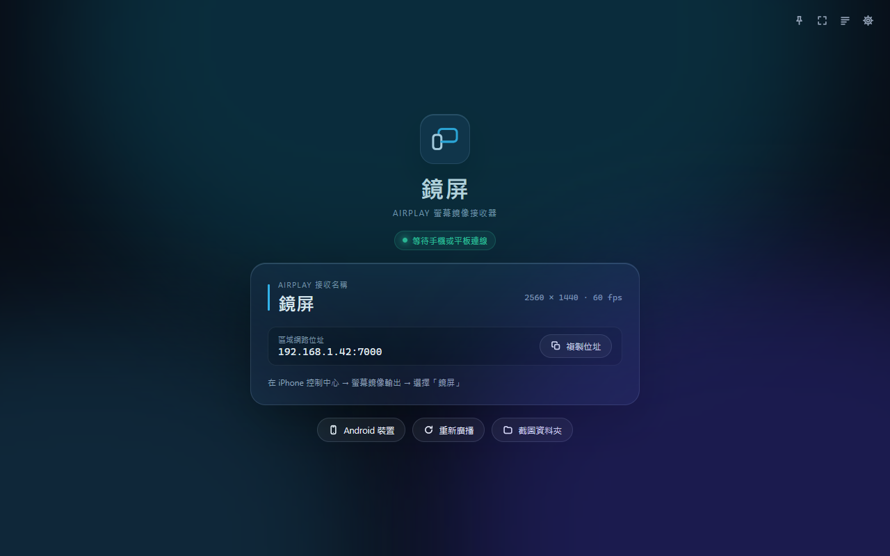
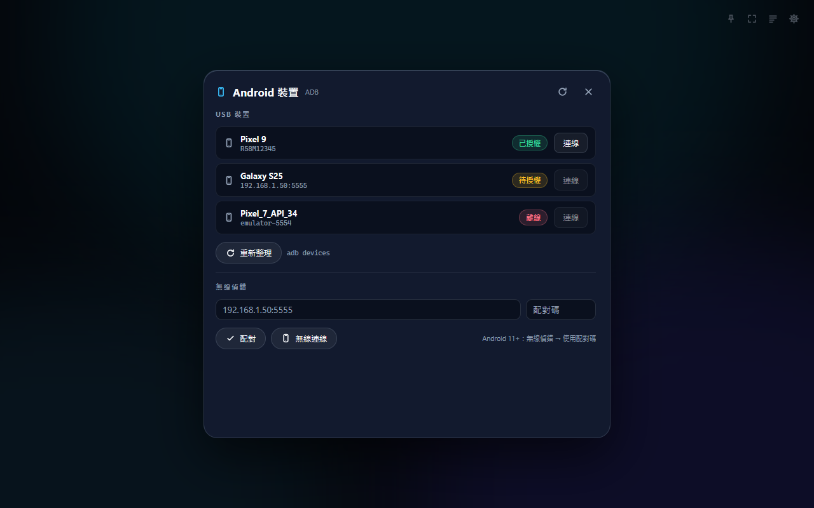
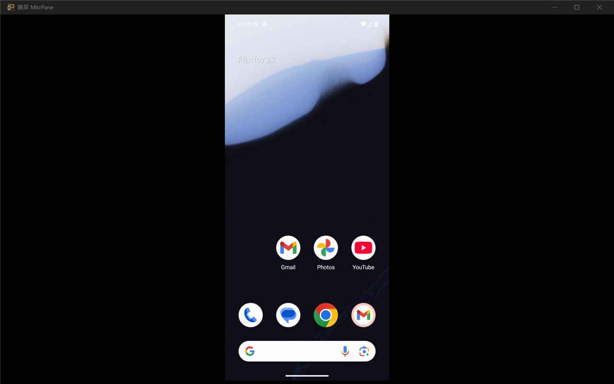
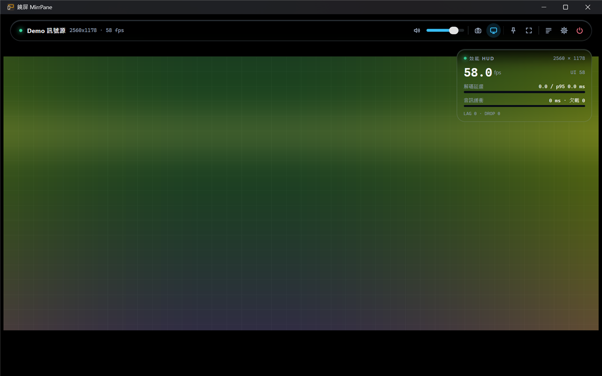
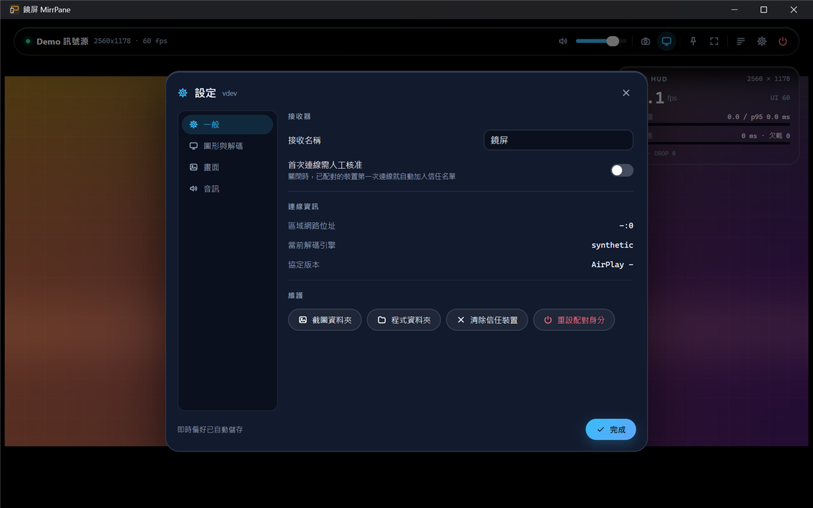

# MirrPane User Guide

MirrPane turns a Windows PC into an **AirPlay screen-mirroring receiver for iPhone and iPad**, and can also mirror an **Android phone** over ADB into the same window, with your mouse, wheel and keyboard operating the phone.

- Project home: [README](../README.en.md)
- Download: [Windows installer (recommended)](https://github.com/Miku0139oao/MirrPane/releases/latest) · [Portable, full](https://github.com/Miku0139oao/MirrPane/releases/latest) · [Portable, lite](https://github.com/Miku0139oao/MirrPane/releases/latest)

---

## 1. Requirements

| Item | Requirement |
| :--- | :--- |
| System | Windows 10 / 11 x64 |
| Network | PC and phone on the same local network (same Wi-Fi or router) |
| iPhone / iPad | Any model that supports AirPlay Screen Mirroring |
| Android | Android 11 or later (audio needs 11+; video works from 5.0) |
| Android connection | `adb` (Android Platform Tools) on the PC, see section 3 |
| Privileges | No administrator rights required |

---

## 2. Install and first launch

### 2.1 Installer (recommended)

1. Download `MirrPane-<version>-setup.exe` from [Releases](https://github.com/Miku0139oao/MirrPane/releases/latest).
2. Run it. The installer is **per-user**, needs no administrator rights, and installs to
   `%LOCALAPPDATA%\Programs\MirrPane`.
3. It adds a Start Menu shortcut and, optionally, a desktop shortcut.
4. To remove it, open **Settings → Apps → Installed apps**, find MirrPane and uninstall.

### 2.2 Portable builds (no installation)

- **Full** `MirrPane-<version>-win64.zip`: bundles the FFmpeg runtime; extract and run offline.
- **Lite** `MirrPane-<version>-win64-lite.zip`: no FFmpeg (about 10 MB). The **first launch needs a network connection**; it downloads and SHA-256-verifies the pinned runtime.

Extract to a writable folder (for example `D:\Tools\MirrPane`) and run `MirrPane.exe`. Settings, logs and screenshots stay in that folder; no registry keys are written.

> To verify a download, compare its SHA-256 from `Get-FileHash` with the `.sha256` file beside it.

### 2.3 What the first launch shows

1. **Windows SmartScreen**: release builds are not code-signed yet, so Windows may show “Windows protected your PC”. Choose **More info → Run anyway**.
2. **Windows Firewall**: the first launch asks whether `MirrPane.exe` may access the network. Allow **private networks** (AirPlay and wireless Android debugging need it). If you dismissed it, re-allow the app under **Windows Security → Firewall & network protection → Allow an app through firewall**.
3. The window shows “starting receiver”, then the **waiting screen**.

> Only one MirrPane runs per logon session. Launching it again brings the existing window to the front instead of starting a second receiver.

---

## 3. Using an iPhone or iPad (AirPlay)



1. Make sure the iPhone/iPad and the PC are on the **same Wi-Fi**.
2. On the iPhone/iPad open **Control Center**:
   - Face ID models: swipe down from the top-right corner.
   - Touch ID models: swipe up from the bottom.
3. Tap **Screen Mirroring** (the two overlapping rectangles).
4. Choose the receiver in the list (the default name is **鏡屏**).
5. The waiting screen turns into the phone's screen and mirroring starts.

### Does the first connection need approval?

- **Not by default**: a paired device is added to the trust list on first use.
- To approve every new device yourself, open **Settings → General → Require manual approval for the first connection**. A “pending device” card then appears on the waiting screen; check the name and fingerprint, press **Allow connection**, then select the receiver again on the phone.
- To forget all trusted devices: **Settings → General → Maintenance → Clear trusted devices**. The next connection is added again (automatically, or after approval).

### Audio

AirPlay audio plays through the **current default Windows playback device**. If you hear nothing:

1. Make sure the toolbar is not muted and the volume is not 0 (`M` toggles mute).
2. In the Windows volume mixer, make sure MirrPane is not muted.
3. Make sure Bluetooth headphones (for example AirPods) are connected to **this PC** and are being worn; unworn headphones play “somewhere” you cannot hear.
4. If it is still silent, see the troubleshooting steps in section 8.

---

## 4. Using an Android phone (ADB / scrcpy)

MirrPane embeds the [scrcpy](https://github.com/Genymobile/scrcpy) 5.0.1 client; you do not need to install scrcpy, but the PC needs Android's `adb`.

### 4.1 Prepare `adb` (once)

Any of these:

- **winget** (recommended):

  ```powershell
  winget install --id Google.PlatformTools -e
  ```

- Or download [Android Platform Tools](https://developer.android.com/tools/releases/platform-tools), extract it and add the folder to `PATH`.
- MirrPane searches: the `MIRRPANE_ADB` environment variable → `PATH` → the WinGet install → `%LOCALAPPDATA%\Android\Sdk\platform-tools` → an Android SDK under your user folder → `platform-tools` beside the app.
- You can also point `MIRRPANE_ADB` directly at `adb.exe`.

### 4.2 Enable USB debugging on the phone

1. **Settings → About phone → Build number**: tap it seven times to unlock **Developer options**.
2. **Settings → System → Developer options → USB debugging**: turn it on.
3. Connect the phone over USB; when the phone asks “Allow USB debugging?”, tap **Allow** (ticking “Always allow” is convenient).

### 4.3 USB connection (quickest)



1. On the waiting screen press **Android 裝置** (Android devices).
2. The dialog lists the phones adb can see (model and serial). States:
   - **已授權** (authorized): ready to connect.
   - **待授權** (unauthorized): accept the USB-debugging prompt on the phone.
   - **離線** (offline): replug the cable, or run `adb kill-server` and refresh.
3. Press **連線** (Connect) on the phone's row. The screen switches to the phone, and the toolbar gains Android navigation buttons.

### 4.4 Wireless connection (Android 11+)

1. Phone and PC on the same Wi-Fi.
2. **Developer options → Wireless debugging**: turn it on and open **Pair device with pairing code**.
3. Enter the “IP address & port” shown on the phone (for example `192.168.1.50:37123`) and the 6-digit pairing code into MirrPane's Android dialog.
4. Press **配對** (Pair), then **無線連線** (Connect wirelessly). If it fails, check the port on the phone or pair once over USB.
5. After connecting, the device appears in the list and can be connected directly next time.

> The wireless-debugging port can change every time it is enabled; use the port the phone shows now.

### 4.5 Operating Android with mouse and keyboard



| Input | Android action |
| :--- | :--- |
| Left click | Tap |
| Left-button drag | Swipe (scroll lists, pull down the shade) |
| Wheel | Scroll |
| `Esc` | Back |
| Arrow keys / `Enter` / `Backspace` / `Tab` | The matching Android keys |
| Toolbar “←” | Back |
| Toolbar “Home” | Home |
| Toolbar “▣” | Recents |
| Toolbar “↻” | Rotate the phone |

- In Android mode a **double click does not toggle fullscreen** (it would send two taps to the phone); use `F11` or the fullscreen button.
- Android audio (Android 11+) plays as 48 kHz stereo through the default Windows output; volume, mute and the anti-jitter buffer are shared with AirPlay.
- Android text input currently forwards only navigation keys (arrows, Enter, Backspace, Tab, Esc); **letters and IME typing are not supported yet**. Type directly on the phone when needed.
- To end an Android session: the power button at the far right of the toolbar, or **Android 裝置 → Disconnect**.
- AirPlay and Android are mutually exclusive: if an iPhone starts mirroring while Android is connected, Android yields; while AirPlay is live, Android connections are refused.

---

## 5. Interface tour

### 5.1 Waiting screen


| Area | Meaning |
| :--- | :--- |
| Receiver name | The name iPhone/iPad show under Screen Mirroring; editable in Settings |
| Resolution · frame rate | Virtual display canvas and advertised frame rate (the phone is scaled into it) |
| LAN address | The PC's IP and AirPlay port; **Copy address** puts it on the clipboard |
| One-line guide | Control Center → Screen Mirroring → pick MirrPane |
| Android devices | Opens the Android connection dialog |
| Re-broadcast | Restarts the receiver (after mDNS changes or when the phone cannot find it) |
| Screenshots folder | Opens `screenshots\` |
| Top-right icons | Always on top, fullscreen, logs, settings |

### 5.2 Live toolbar and HUD



The toolbar hides after 2 seconds without pointer movement; move the pointer to reveal it. From left to right:

| Control | Meaning |
| :--- | :--- |
| Sender · resolution · fps | Current source and stream state; Android adds “· Android” |
| Speaker + slider | Mute and volume (`M` toggles mute) |
| Camera | Snapshot (`Ctrl+S`) into `screenshots\` |
| Display icon | “Display” menu: rotate, flip, fill, performance HUD |
| Pin | Always on top (`Ctrl+T`) |
| Fullscreen | Enter/leave fullscreen (`F11`; double-click also works, except in Android mode) |
| Document icon | Logs (`Ctrl+L`) |
| Gear | Settings (`Ctrl+,` or `Ctrl+K`) |
| Power | Disconnect, or end the Android session |

**Display menu** (the display icon in the toolbar):

- **Rotate 90°** (`R`)
- **Flip horizontally** (`H`)
- **Fill the window** (`Z`): crop the edges to fill; off keeps the full aspect ratio
- **Performance HUD** (`Tab`)

**Performance HUD** shows:

- Current fps and resolution
- Decode latency (average / p95 against the 16.7 ms budget at 60 fps)
- Audio buffer (milliseconds / underruns)
- LAG (producer-to-UI frame distance) and DROP (frames skipped because they could not be shown)

The HUD corner is configurable; when the HUD is off it takes no space.

### 5.3 Settings



Four sections in the sidebar. Settings that apply instantly take effect immediately; settings that need a restart collect in the footer as “changes need a restart”, and **Apply and restart** restarts the receiver (the current mirroring drops briefly).

**General**

- Receiver name (needs restart).
- Require manual approval for the first connection (see section 3).
- Connection info: LAN address, current decoder, AirPlay version.
- Maintenance: open screenshots folder, open program folder, clear trusted devices, reset pairing identity (every phone pairs again on its next connection).

**Graphics & decoding** (need restart)

| Option | Meaning |
| :--- | :--- |
| Resolution | Virtual display canvas: 1280×720 / 1920×1080 / 2560×1440 / 3840×2160 |
| Advertised frame-rate cap | 60 fps or 30 fps |
| H.264 decoding | Automatic (D3D11VA hardware) or software |
| Input colour range | Auto / full / limited |
| YUV → RGBA conversion | Fast / bilinear / bicubic |

> iPhones scale their picture into the advertised canvas (for example 2560×1440); when the canvas is larger than the phone's aspect ratio you get black bars. Raising the resolution does not make the picture sharper.

**Picture** (instant)

- Fill the window (Z), flip horizontally (H)
- Scaling: sharp (pixelated) or smooth (interpolated)
- Performance HUD (Tab), HUD corner, toolbar auto-hide (never / 2 s / 4 s)
- Brightness (−0.3 to +0.3), contrast (0.7 to 1.4), saturation (0.5 to 1.5)
- Reset picture preferences

**Audio**

- Volume and mute (M)
- Anti-jitter buffer (needs restart): low latency / balanced / stable. Low latency reacts fastest; stable absorbs Wi-Fi bursts with a larger buffer.

---

## 6. Keyboard shortcuts

| Key | Action |
| :--- | :--- |
| `F11` | Fullscreen |
| `Esc` | Close settings/logs, leave fullscreen; in Android mode: Back |
| `Ctrl+T` | Always on top |
| `Ctrl+,` or `Ctrl+K` | Settings |
| `Ctrl+L` | Logs |
| `Ctrl+S` | Snapshot (while mirroring) |
| `R` | Rotate 90° |
| `H` | Flip horizontally |
| `Z` | Fill the window |
| `M` | Mute |
| `Tab` | Performance HUD; in Android mode: forwarded to the phone |
| Double-click | Toggle fullscreen (not in Android mode) |

Single-letter shortcuts do not fire while a text field has focus.

---

## 7. File locations

| Content | Installer | Portable |
| :--- | :--- | :--- |
| Program | `%LOCALAPPDATA%\Programs\MirrPane` | The extracted folder |
| Settings | `config\config.json` in the program folder | `config\config.json` |
| UI preferences | `config\ui_prefs.json` | same |
| Trusted devices | `config\trusted_senders.json` | same |
| Logs | `logs\airplayd.log` | same |
| Screenshots | `screenshots\` | same |
| FFmpeg | `ffmpeg\` in the program folder (lite downloads on first launch) | same |
| MyGo shader cache | `%LOCALAPPDATA%\MyGo\ShaderCache` (the only file outside the app folder) | same |

---

## 8. Troubleshooting

### The phone cannot find MirrPane under Screen Mirroring

- Make sure both devices are on the same Wi-Fi/subnet (mobile data on the phone, or an AP-isolated router, hides the receiver).
- Check Windows Firewall allows `MirrPane.exe` (private networks) and mDNS on UDP 5353.
- A VPN in TUN mode or a virtual adapter can route mDNS to the wrong interface; disable it temporarily.
- Press **Re-broadcast** on the waiting screen, or restart MirrPane.

### The picture keeps dropping

- The interrupted card shows the reason; press **Restart receiver** and select the receiver again on the phone.
- Large mirroring traffic benefits from 5 GHz; check Wi-Fi signal quality.

### No sound

1. Toolbar volume is above 0 and not muted (`M`).
2. In the Windows volume mixer MirrPane is not muted and the default output is correct.
3. Bluetooth headphones are connected to **this PC** and being worn (unworn AirPods play where you cannot hear them).
4. In **Settings → Audio**, set the anti-jitter buffer to **stable**, or raise the volume.
5. Android: make sure the phone is Android 11+ and its media volume is not 0.
6. Otherwise open the logs (`Ctrl+L`) and report the recent lines on [Issues](https://github.com/Miku0139oao/MirrPane/issues). The log records whether audio packets arrived, whether they were dropped, and from which address.

### “Port 7000 is already in use”

AirPlay prefers port 7000. When it is taken MirrPane picks another port, but the phone may still see the old broadcast. Close other AirPlay receivers, press **Re-broadcast**, or restart MirrPane.

### The Android dialog cannot find adb

- Install Platform Tools: `winget install --id Google.PlatformTools -e`, then restart MirrPane.
- Or set `MIRRPANE_ADB` to the full path of `adb.exe`.
- If adb itself misbehaves, run `adb start-server` in a terminal to see its error.

### Android shows “unauthorized” or “offline”

- Unauthorized: unlock the phone and accept the USB-debugging prompt.
- Offline: try a **data-capable** USB cable (some only charge), another USB port, or `adb kill-server` and refresh the list.
- Wireless debugging: both devices on the same subnet, and the pairing code not expired (regenerate it on the phone if needed).

### Wrong aspect ratio or black bars

This is the AirPlay canvas: the phone fits its picture into the advertised resolution. Pick a resolution closer to the phone's aspect ratio to reduce bars, or enable **Fill the window** to crop the edges.

### A second MirrPane will not open

One receiver per logon session; launching again brings the existing window to the front.

### The lite build takes a long time on first launch

It downloads the FFmpeg runtime (about 129 MB) and verifies its SHA-256; a network connection is required once. Interrupted downloads resume on the next launch.

---

## 9. Updating and uninstalling

- **Update**: run the newer installer over the old one (settings in `config\` are kept). For the portable build, extract to a new folder or overwrite the program files (keep `config\`, `logs\`, `screenshots\`).
- **Uninstall (installer)**: Settings → Apps → Installed apps → MirrPane → Uninstall; you can remove settings and logs with it.
- **Portable**: delete the folder; back up `config\` first if you want to keep settings.

---

## 10. Privacy and security

- The receiver verifies the phone's pairing public key. Paired devices are trusted on first use and recorded in `config\trusted_senders.json`; enable manual approval or clear the list in Settings.
- Windows protects the pairing key seed with DPAPI; file permissions restrict the configuration and trust list.
- The local management API listens on `127.0.0.1` only and validates `Host` and `Origin`.
- An Android session talks only to the selected device through the local `adb`; input events go nowhere else, and device serials and wireless addresses are validated.

---

## 11. Licence and acknowledgements

MirrPane is licensed under **GPL-3.0**. The embedded scrcpy server (Apache-2.0) and other third-party notices are in `THIRD_PARTY_LICENSES.txt` in each release. Thanks to [UxPlay](https://github.com/FDH2/UxPlay), [FFmpeg](https://ffmpeg.org/), [BtbN/FFmpeg-Builds](https://github.com/BtbN/FFmpeg-Builds), [scrcpy](https://github.com/Genymobile/scrcpy) and [MyGo](https://github.com/egoist/mygo).
