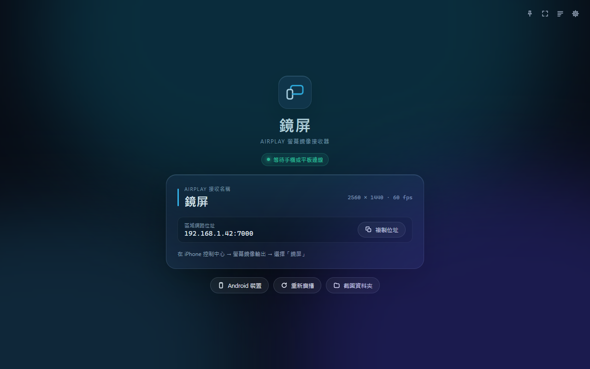
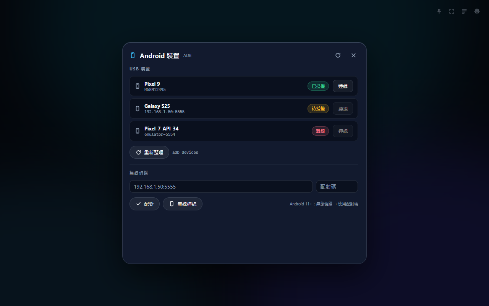
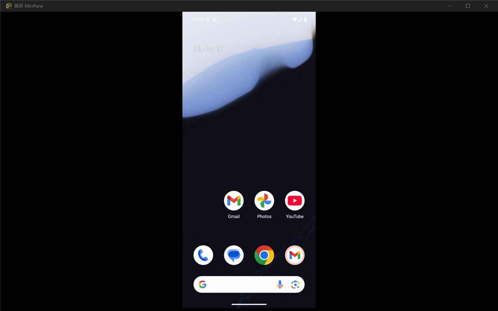
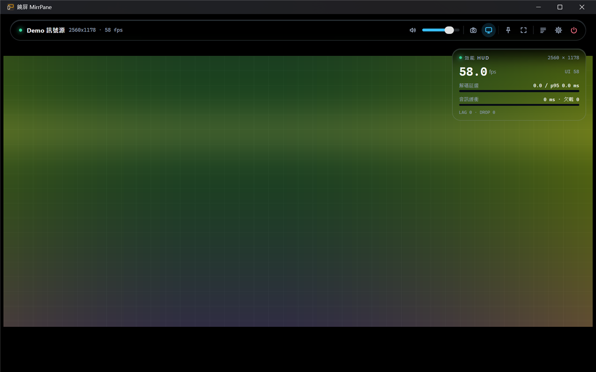
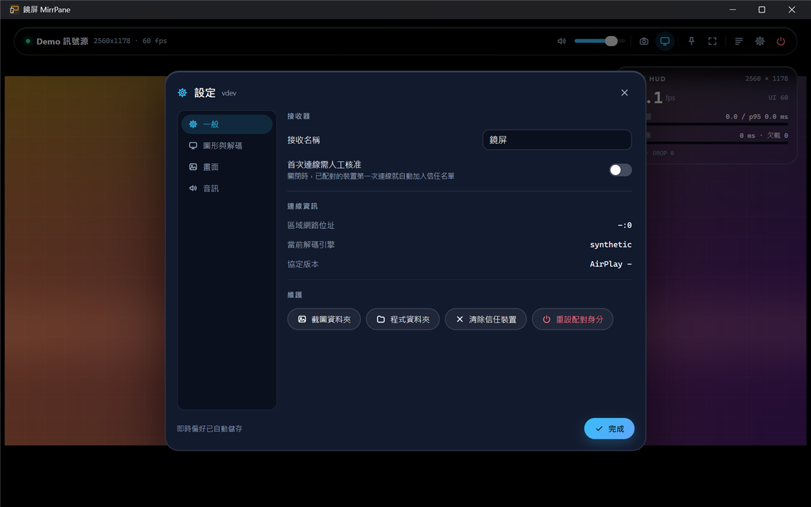

# 鏡屏 MirrPane 使用教學

鏡屏（MirrPane）把 Windows 電腦變成 **iPhone / iPad 的 AirPlay 螢幕鏡像接收器**，也可以透過 ADB 連接 **Android 手機**，把畫面鏡像到同一個視窗，並用滑鼠、滾輪與鍵盤直接操作手機。

- 專案首頁：[README](../README.md)
- 下載：[Windows 安裝檔（建議）](https://github.com/Miku0139oao/MirrPane/releases/latest) · [便攜完整版](https://github.com/Miku0139oao/MirrPane/releases/latest) · [便攜精簡版](https://github.com/Miku0139oao/MirrPane/releases/latest)

---

## 1. 系統需求

| 項目 | 需求 |
| :--- | :--- |
| 系統 | Windows 10 / 11 x64 |
| 網路 | 電腦與手機在同一個區域網路（同一個 Wi-Fi 或同一個路由器） |
| iPhone / iPad | 支援 AirPlay 螢幕鏡像輸出的機型（iOS / iPadOS） |
| Android | Android 11 以上（音訊需要 11 以上；影像 5.0 以上即可） |
| Android 連線 | 系統需有 `adb`（Android Platform Tools），見第 3 節 |
| 權限 | 不需要系統管理員權限 |

---

## 2. 安裝與第一次啟動

### 2.1 安裝檔（建議）

1. 從 [Releases](https://github.com/Miku0139oao/MirrPane/releases/latest) 下載 `MirrPane-<版本>-setup.exe`。
2. 直接執行。安裝程式是**使用者層級**，不需要管理員權限，會安裝到：
   `%LOCALAPPDATA%\Programs\MirrPane`
3. 安裝完成後會建立開始功能表捷徑，也可以在安裝時勾選桌面捷徑。
4. 要移除時，到「設定 → 應用程式 → 已安裝的應用程式」找到「鏡屏 MirrPane」解除安裝即可。

### 2.2 便攜版（免安裝）

- **完整版** `MirrPane-<版本>-win64.zip`：已附 FFmpeg 執行期，解壓後可直接離線使用。
- **精簡版** `MirrPane-<版本>-win64-lite.zip`：不含 FFmpeg（約 10 MB），**第一次啟動需要連網**，會自動下載並以 SHA-256 驗證固定版本。

解壓到有寫入權限的資料夾（例如 `D:\Tools\MirrPane`），執行 `MirrPane.exe`。設定、日誌與截圖都會留在這個資料夾，不寫入登錄檔。

> 驗證下載：把 `Get-FileHash` 算出的 SHA-256 與下載頁面旁的 `.sha256` 檔比對。

### 2.3 第一次啟動會看到什麼

1. **Windows SmartScreen**：發行檔目前沒有數位簽章，可能顯示「Windows 已保護您的電腦」。選擇「更多資訊 → 仍要執行」。
2. **Windows 防火牆**：第一次啟動時 Windows 會詢問是否允許 `MirrPane.exe` 存取網路。請允許**私人網路**（AirPlay 與 Android 無線連線都需要）。若不小心按了取消，影像會無法連上，可在「Windows 安全性 → 防火牆與網路保護 → 允許應用程式通過防火牆」補允許。
3. 主視窗會先顯示「正在啟動接收器」，接著進入**待機畫面**。

> 同一時間只會有一個鏡屏在執行。重複開啟會把既有視窗帶回前景，不會產生第二個接收器。

---

## 3. 用 iPhone / iPad（AirPlay）



1. 確認 iPhone / iPad 與電腦連到**同一個 Wi-Fi**。
2. 在 iPhone / iPad 打開「控制中心」：
   - Face ID 機型：從螢幕右上角向下滑。
   - Touch ID 機型：從螢幕底部向上滑。
3. 點「**螢幕鏡像輸出**」（兩個重疊矩形的圖示）。
4. 在裝置列表中選擇鏡屏的名稱（預設是「**鏡屏**」）。
5. 電腦上的待機畫面會切換成手機畫面，鏡像就開始了。

### 第一次連線要核准嗎？

- **預設不需要**：裝置完成配對後第一次連線會自動加入信任名單。
- 若你想每台新裝置都人工確認：打開「設定 → 一般 → 首次連線需人工核准」。之後新裝置連線時，待機畫面會出現「待核准裝置」卡片，確認名稱與指紋後按「**允許連線**」，再回手機選一次鏡屏。
- 想清除所有已信任裝置：「設定 → 一般 → 維護 → 清除信任裝置」。下次連線會重新加入（或重新要求核准）。

### 聲音

AirPlay 的聲音會從**Windows 目前的預設播放裝置**播出。若沒有聲音：

1. 確認鏡屏工具列沒有靜音、音量不是 0（`M` 可切換靜音）。
2. 確認 Windows 音量混音器中「鏡屏」沒有被靜音。
3. 確認藍牙耳機（例如 AirPods）已連上**這台電腦**且戴著；藍牙耳機沒戴時，聲音會「播出去但聽不到」。
4. 仍然無聲時，看第 8 節的排錯步驟。

---

## 4. 用 Android（ADB／scrcpy）

鏡屏內建 [scrcpy](https://github.com/Genymobile/scrcpy) 5.0.1 的用戶端；你不需要另外安裝 scrcpy，但電腦上要有 Android 的 `adb`。

### 4.1 準備 `adb`（只需要一次）

任選一種：

- **winget**（建議）：

  ```powershell
  winget install --id Google.PlatformTools -e
  ```

- 或到 Google 的 [Android Platform Tools](https://developer.android.com/tools/releases/platform-tools) 下載 zip，解壓後把資料夾加入 `PATH`。
- 鏡屏會依序尋找：`MIRRPANE_ADB` 環境變數 → `PATH` → WinGet 安裝的 Platform Tools → `%LOCALAPPDATA%\Android\Sdk\platform-tools` → 使用者資料夾下的 Android SDK → 執行檔旁的 `platform-tools`。
- 也可以直接把 `adb.exe` 的位置設在環境變數 `MIRRPANE_ADB`。

### 4.2 開啟手機的 USB 偵錯

1. 手機「設定 → 關於手機 → 版本號碼」，連續點 7 次開啟「開發人員選項」。
2. 「設定 → 系統 → 開發人員選項 → **USB 偵錯**」打開。
3. 用 USB 線連接電腦；手機跳出「允許 USB 偵錯嗎？」時選**允許**（建議勾選「一律允許」）。

### 4.3 USB 連線（最快）



1. 在待機畫面按「**Android 裝置**」。
2. 對話框會列出目前偵測到的手機（型號與序號）。狀態顯示：
   - **已授權**：可以連線。
   - **待授權**：回到手機按「允許 USB 偵錯」。
   - **離線**：重新插拔 USB 線或執行 `adb kill-server` 後再試。
3. 在手機那一列按「**連線**」。畫面會切換成手機畫面，工具列左側多出 Android 的導覽按鈕。

### 4.4 無線連線（Android 11 以上）

1. 手機與電腦連到同一個 Wi-Fi。
2. 手機「開發人員選項 → **無線偵錯**」打開，進入「使用配對碼配對裝置」。
3. 把畫面上的「IP 位址與連接埠」（例如 `192.168.1.50:37123`）和 6 位數配對碼填到鏡屏的 Android 對話框。
4. 按「**配對**」，成功後再按「**無線連線**」（若連不上，回手機確認無線偵錯頁面的連線埠，或改用 USB 一次）。
5. 連線成功後，手機那一列會出現在清單中，之後可直接按「連線」。

> 無線偵錯的連接埠每次開啟可能不同；以手機當下顯示的為準。

### 4.5 用滑鼠與鍵盤操作 Android



| 操作 | 對應 Android 行為 |
| :--- | :--- |
| 滑鼠左鍵點一下 | 點擊 |
| 按住左鍵拖曳 | 滑動（可捲動清單、拉通知欄） |
| 滾輪 | 捲動 |
| `Esc` | 返回鍵 |
| 方向鍵 / `Enter` / `Backspace` / `Tab` | 對應 Android 按鍵 |
| 工具列「←」 | 返回 |
| 工具列「Home」 | 主畫面 |
| 工具列「▣」 | 最近應用 |
| 工具列「↻」 | 旋轉手機畫面 |

- 在 Android 模式下，**雙擊畫面不會切換全螢幕**（避免誤送兩個點擊）；請用 `F11` 或工具列的全螢幕按鈕。
- Android 的聲音（Android 11 以上）會以 48 kHz 立體聲從 Windows 預設裝置播放，音量、靜音與抗抖動緩衝和 AirPlay 共用。
- Android 的文字輸入目前只轉送導覽鍵（方向鍵、Enter、Backspace、Tab、Esc），**英文字母與中文 IME 尚未支援**；需要打字時請直接用手機輸入。
- 要結束 Android 連線：工具列最右側的電源鍵，或再開「Android 裝置」按「中斷連線」。
- AirPlay 與 Android 一次只能有一個：Android 連線中若有 iPhone 要鏡像，Android 會自動讓位；AirPlay 連線中則會拒絕啟動 Android。

---

## 5. 介面導覽

### 5.1 待機畫面


| 區域 | 說明 |
| :--- | :--- |
| 接收名稱 | iPhone / iPad 在「螢幕鏡像輸出」看到的名稱，可在設定修改 |
| 解析度 · 幀率 | 虛擬顯示器大小與宣告幀率（手機影像會等比縮放進來） |
| 區域網路位址 | 電腦的 IP 與 AirPlay 連接埠；「複製位址」可貼到別處 |
| 一行指引 | 控制中心 → 螢幕鏡像輸出 → 選擇鏡屏 |
| Android 裝置 | 開啟 Android 連線對話框 |
| 重新廣播 | 重新啟動接收器（mDNS 廣播消失或改設定後使用） |
| 截圖資料夾 | 開啟 `screenshots\` 資料夾 |
| 右上角圖示 | 視窗置頂、全螢幕、日誌、設定 |

### 5.2 直播工具列與 HUD



工具列預設在 2 秒沒有滑鼠移動後自動隱藏；移到畫面上方或移動滑鼠就會出現。由左到右：

| 控制 | 說明 |
| :--- | :--- |
| 發送端 · 解析度 · fps | 目前鏡像來源與串流狀態；Android 會顯示「· Android」 |
| 喇叭圖示 + 音量滑桿 | 靜音／音量（`M` 切換靜音） |
| 相機 | 截圖（`Ctrl+S`），存到 `screenshots\` |
| 螢幕圖示 | 「畫面調整」選單：旋轉、水平翻轉、填滿視窗、效能 HUD |
| 圖釘 | 視窗置頂（`Ctrl+T`） |
| 全螢幕 | 進入／離開全螢幕（`F11`；雙擊畫面也可切換，Android 模式除外） |
| 文件圖示 | 日誌（`Ctrl+L`） |
| 齒輪 | 設定（`Ctrl+,` 或 `Ctrl+K`） |
| 電源 | 中斷連線／停止 Android 工作階段 |

**畫面調整選單**（工具列上的螢幕圖示）：

- **旋轉 90°**（`R`）：把畫面轉向；再按一次繼續轉。
- **水平翻轉**（`H`）：鏡像顯示。
- **填滿視窗**（`Z`）：裁切邊緣填滿整個視窗；關閉時保持完整比例。
- **效能 HUD**（`Tab`）：顯示即時指標。

**效能 HUD** 會顯示：

- 目前 fps 與解析度
- 解碼延遲（平均 / p95，預算 16.7 ms 對應 60 fps）
- 音訊緩衝（毫秒 / 欠載次數）
- LAG（生產者與 UI 的影格差）與 DROP（來不及顯示而丟棄的影格）

HUD 位置可在設定中改為左上、右上、左下、右下；效能 HUD 關閉時不佔畫面。

### 5.3 設定



左側四個分頁；修改**即時生效**的項目會立刻套用，需要重新啟動接收器的項目會在頁腳出現「已修改需重啟的設定」，按「**套用並重啟**」才會生效（會短暫中斷目前的鏡像）。

**一般**

- 接收名稱：AirPlay 廣播名稱（需重啟）。
- 首次連線需人工核准：見第 3 節。
- 連線資訊：區域網路位址、目前解碼引擎、AirPlay 協定版本。
- 維護：開啟截圖資料夾、開啟程式資料夾、清除信任裝置、重設配對身分（會讓所有手機下次連線時重新配對）。

**圖形與解碼**（需重啟）

| 選項 | 說明 |
| :--- | :--- |
| 解析度 | 虛擬顯示器畫布：1280×720 / 1920×1080 / 2560×1440 / 3840×2160 |
| 宣告幀率上限 | 60 fps 或 30 fps |
| H.264 解碼 | 自動（D3D11VA 硬體）或軟體解碼 |
| 輸入色彩範圍 | 自動 / 完整 / 有限 |
| YUV → RGBA 轉換 | 快速 / 雙線性 / 雙三次 |

> iPhone 會把手機畫面等比縮放置入宣告的畫布（例如 2560×1440），畫布比手機畫面大時會留黑邊，這是正常現象；把解析度調大不會讓畫面變糊。

**畫面**（即時生效）

- 填滿視窗（Z）、水平翻轉（H）
- 縮放取樣：銳利（像素）或平滑（插值）
- 顯示效能 HUD（Tab）、HUD 位置、工具列自動隱藏（不隱藏 / 2 秒 / 4 秒）
- 亮度（−0.3 ～ +0.3）、對比（0.7 ～ 1.4）、飽和度（0.5 ～ 1.5）
- 重設畫面偏好

**音訊**

- 音量與靜音（M）
- 抗抖動緩衝（需重啟）：低延遲 / 平衡 / 穩定。低延遲反應最快；穩定以較大的緩衝吸收 Wi-Fi 突發壅塞。

---

## 6. 鍵盤快捷鍵

| 按鍵 | 功能 |
| :--- | :--- |
| `F11` | 全螢幕 |
| `Esc` | 關閉設定／日誌視窗、離開全螢幕；Android 模式下是「返回」 |
| `Ctrl+T` | 視窗置頂 |
| `Ctrl+,` 或 `Ctrl+K` | 設定 |
| `Ctrl+L` | 日誌 |
| `Ctrl+S` | 截圖（需在鏡像中） |
| `R` | 旋轉 90° |
| `H` | 水平翻轉 |
| `Z` | 填滿視窗 |
| `M` | 靜音 |
| `Tab` | 效能 HUD；Android 模式下轉送 Tab 到手機 |
| 雙擊畫面 | 切換全螢幕（Android 模式除外） |

單字母快捷鍵在輸入框中打字時不會觸發。

---

## 7. 檔案位置

| 內容 | 安裝版 | 便攜版 |
| :--- | :--- | :--- |
| 程式 | `%LOCALAPPDATA%\Programs\MirrPane` | 解壓資料夾 |
| 設定 | 程式資料夾 `config\config.json` | 解壓資料夾 `config\config.json` |
| 介面偏好 | `config\ui_prefs.json` | 同左 |
| 信任裝置 | `config\trusted_senders.json` | 同左 |
| 日誌 | `logs\airplayd.log` | 同左 |
| 截圖 | `screenshots\` | 同左 |
| FFmpeg | 程式資料夾 `ffmpeg\`（精簡版首次啟動下載） | 同左 |
| MyGo 著色器快取 | `%LOCALAPPDATA%\MyGo\ShaderCache`（唯一寫在程式資料夾外的檔案） | 同左 |

---

## 8. 常見問題與排錯

### 手機在「螢幕鏡像輸出」看不到鏡屏

- 確認兩台裝置在同一個 Wi-Fi / 網段（手機用行動網路、電腦用乙太網路且路由器有 AP 隔離時會看不到）。
- 檢查 Windows 防火牆是否允許 `MirrPane.exe`（私人網路）與 UDP 5353（mDNS）。
- 若使用 VPN 的 TUN 模式或虛擬網卡，mDNS 廣播可能走錯介面；暫時關閉 VPN 試試。
- 按待機畫面的「重新廣播」，或重啟鏡屏。

### 連上後畫面中斷

- 中斷卡片會顯示原因；可先按「重啟接收器」再從手機重新選一次鏡屏。
- 若經常中斷，確認 Wi-Fi 訊號與 2.4/5 GHz 頻段；鏡像流量較大，建議 5 GHz。

### 沒有聲音

1. 工具列音量不是 0、沒有靜音（`M`）。
2. Windows 音量混音器裡「鏡屏」沒被靜音，預設輸出裝置正確。
3. 藍牙耳機已連到**這台電腦**且戴著（AirPods 沒戴時聲音會「播到耳機但聽不到」）。
4. 從「設定 → 音訊」把抗抖動緩衝改成「穩定」，或提高音量。
5. 如果是 Android：確認手機是 Android 11 以上；Android 的媒體音量不是 0。
6. 還是不行：打開日誌（`Ctrl+L`），把近期內容回報到 [Issues](https://github.com/Miku0139oao/MirrPane/issues)。日誌會記錄音訊封包是否到達、是否被丟棄、來源位址等資訊。

### 顯示「連接埠 7000 已被其他程式使用」

AirPlay 預設使用 7000；被占用時鏡屏會自動改用其他埠，但手機可能仍看到舊的廣播。關閉其他 AirPlay 接收軟體、按「重新廣播」，或重新啟動鏡屏即可。

### Android 對話框顯示找不到 adb

- 安裝 Platform Tools：`winget install --id Google.PlatformTools -e`，然後重新開啟鏡屏。
- 或設定環境變數 `MIRRPANE_ADB` 指向 `adb.exe` 的完整路徑。
- 開著 VPN 或防火牆時，adb 的本機連線通常不受影響；若 adb 本身異常，可在命令列執行 `adb start-server` 看錯誤訊息。

### Android 顯示「待授權」或「離線」

- 待授權：解鎖手機，在「允許 USB 偵錯嗎？」按允許。
- 離線：換一條 **可傳資料** 的 USB 線（有些線只能充電）、換 USB 埠，或執行 `adb kill-server` 後重新整理裝置清單。
- 無線偵錯：確認手機與電腦同網段、配對碼未過期（過期就回手機重新產生）。

### 畫面比例不對／有黑邊

這是 AirPlay 的畫布機制：手機會把手機畫面等比放進宣告的解析度畫布。想要少一點黑邊可把解析度改成接近手機比例的選項，或在「畫面」開啟「填滿視窗」裁切邊緣。

### 第二個鏡屏打不開

同一登入工作階段只允許一個接收器；重複啟動會把既有視窗帶回前景。

### 精簡版第一次啟動很久

精簡版會在第一次啟動下載 FFmpeg 執行期（約 129 MB）並驗證 SHA-256；需要網路，之後即可離線使用。若中斷，下一次啟動會續傳。

---

## 9. 更新與解除安裝

- **更新**：下載新版安裝檔直接安裝（會保留 `config\` 與設定）；便攜版解壓到**新資料夾**或覆蓋程式檔（保留 `config\`、`logs\`、`screenshots\`）。
- **解除安裝（安裝版）**：設定 → 應用程式 → 已安裝的應用程式 → 鏡屏 MirrPane → 解除安裝。可一併刪除設定與日誌。
- **便攜版**：直接刪除資料夾；若要保留設定，先備份 `config\`。

---

## 10. 隱私與安全性

- 接收器會核對手機的配對公鑰；已配對裝置預設首次使用即信任，名單存於 `config\trusted_senders.json`。可在設定開啟人工核准或清除信任裝置。
- Windows 以 DPAPI 保護配對金鑰種子；設定與信任名單受檔案權限保護。
- 本機管理 API 只監聽 `127.0.0.1`，並檢查 `Host` 與 `Origin`。
- Android 工作階段只透過本機 `adb` 與你選擇的裝置溝通；輸入事件只送往該裝置，且會驗證裝置序號與無線位址格式。

---

## 11. 授權與致謝

鏡屏以 **GPL-3.0** 授權。內嵌的 scrcpy server（Apache-2.0）與其他第三方元件的授權，見發行版內的 `THIRD_PARTY_LICENSES.txt`。感謝 [UxPlay](https://github.com/FDH2/UxPlay)、[FFmpeg](https://ffmpeg.org/)、[BtbN/FFmpeg-Builds](https://github.com/BtbN/FFmpeg-Builds)、[scrcpy](https://github.com/Genymobile/scrcpy) 與 [MyGo](https://github.com/egoist/mygo)。
